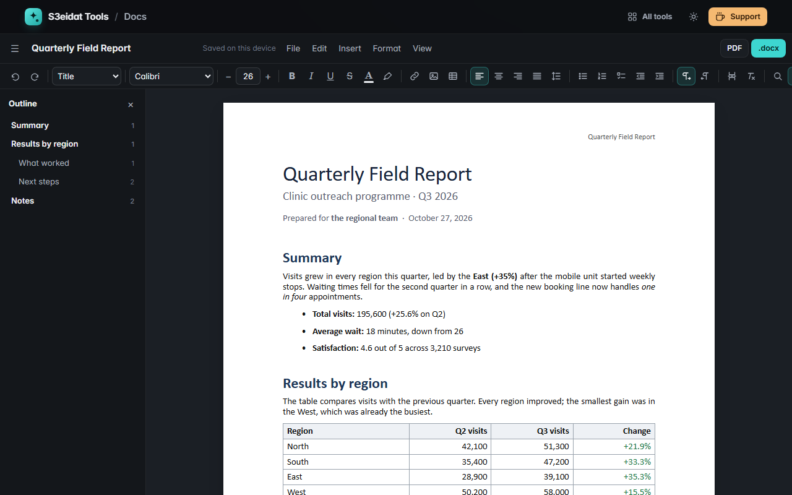

# Docs

> A word processor that works on real pages, opens and saves .docx and prints exact PDFs. Free, private, offline, and it runs entirely in your browser.

A free alternative to word processors like Word and Google Docs, for one person writing on one device: no account, no server, nothing uploaded.

### ▶ [Open Docs](https://s3eidat.github.io/docs/)



## Features

- **Real pages**: A4, Letter, Legal, A5, B5 or a custom size, portrait or landscape, your margins. A pagination engine splits long paragraphs at line boundaries and long tables between rows (the header row repeats), keeps headings with the next line and avoids single orphan lines
- **Styles**: Normal, Title, Subtitle, Heading 1–3, Quote and Code, plus a default font, size, line spacing and paragraph spacing per document
- **Text formatting**: fonts installed on your device (Arabic fonts too), size, bold, italic, underline, strikethrough, superscript, subscript, text colour, highlight, links (web and email only), clear formatting
- **Paragraphs**: left / centre / right / justify, line spacing, space before / after, indents, first-line and hanging indents, right-to-left paragraphs (automatic from the text, or set per paragraph)
- **Lists**: bulleted, numbered and checklists, nested up to 9 levels (1. → a. → i.)
- **Tables**: insert from a size grid, add / remove rows and columns, merge and split cells, cell shading, header row, drag column borders to resize
- **Images**: from your device (paste or drop works too), drag to resize, left / centre / right, alt text
- **Page breaks, headers and footers** with page number, page count, title and date fields, and an optional different first page
- **Table of contents** built from your headings, with live page numbers and click-to-jump
- **Find and replace** (match case, whole words), outline sidebar, word and character count, undo / redo, zoom and fit to width
- **Templates** (our own): letter, CV, report with title page and contents, APA-style essay, and an Arabic formal letter
- **Open**: .docx (paragraphs, headings and styles, bold / italic / underline / strike / colour / highlight / size / font, alignment, lists, tables with merged cells, images, page breaks, page size and margins, header and footer text), plus .md, .txt and .html
- **Save**: .docx, PDF (print → Save as PDF, page for page), Markdown (zip with images), HTML (images embedded) and plain text
- Autosaves to this browser (IndexedDB), keeps a list of your recent documents, works offline after the first visit, light and dark themes

## Limits

Single user on one device: no sharing, comments, track changes or cloud sync. One page setup per document (no mixed sections), no footnotes, text boxes, floating images, columns, equations or fields other than page numbers. .docx import keeps the content and its formatting but not every layout detail of complex files; linked (external) images and anything the reader doesn't understand are skipped, never fetched.

## Privacy

Your documents and images are stored in this browser on this device and never leave it. There is no server, no account, no analytics.
The page ships with a strict Content-Security-Policy (`connect-src 'self'`), so the browser itself blocks any attempt to send data anywhere.
Files you open are read as untrusted: size limits before and after unzipping, no XML entities, external links and images ignored, and text is only ever shown as text.
Clearing this site's data deletes your documents, so download a .docx of anything important.

## Run it yourself

It's plain HTML, CSS and JavaScript with no build step:

```bash
git clone https://github.com/s3eidat/docs
cd docs
python -m http.server 8000
```

Then open http://localhost:8000.

Uses [docx](https://github.com/dolanmiu/docx) (MIT) to write .docx files and [JSZip](https://github.com/Stuk/jszip) (MIT) to read them.

## Support

If this saved you time, **[buy me a coffee ☕](https://s3eidat.github.io/coffee/)**. It keeps every tool free.

---

Part of **[S3eidat Tools](https://s3eidat.github.io/)**: 100+ free, private tools that run in your browser. MIT licensed.
